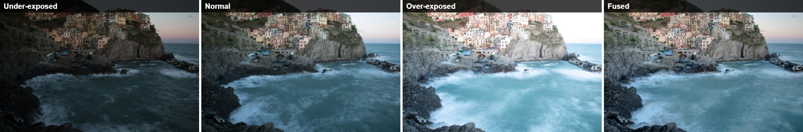

# Exposure Fusion

Implementation from scratch of **Exposure Fusion** (Mertens, Kautz & Van Reeth, 2007): merging a bracketed set of photos (under-, normally and over-exposed) into a single well-exposed image, without building an HDR image or tone mapping.

Course project, 4IM01 Image Processing, Télécom Paris. Authors: Adam Safieddine and Victor Coulet.



## How it works

1. **Quality measures.** For each photo and each pixel we compute three measures:
   - *contrast*: absolute value of a Laplacian filter on the grayscale image;
   - *saturation*: standard deviation of the R, G and B channels;
   - *well-exposedness*: a Gaussian centred on 0.5 (σ = 0.2).

   Their product gives a weight map per photo. The maps are normalised so they sum to 1 at each pixel.
2. **Naive fusion.** A per-pixel weighted average already recovers the sky and the dark rocks, but it produces seams and noise.
3. **Multiresolution fusion.** Each photo is decomposed into a **Laplacian pyramid** and each weight map into a **Gaussian pyramid**. The blending is done level by level, then the image is rebuilt. Coarse levels carry the overall brightness and get very smooth weights, so the transitions disappear.

## Results

- Multiresolution fusion removes the seams and noise of the naive fusion on all three scenes.
- **Number of pyramid levels** is the parameter that matters most. Global contrast goes from 0.153 (4 levels) to 0.230 (maximum number of levels) on Manarola, from 0.157 to 0.245 on the lighthouse and from 0.170 to 0.261 on the waterfall.
- The exponents (ω<sub>C</sub> = ω<sub>S</sub> = ω<sub>E</sub> = 1) and σ = 0.2 proposed in the paper gave the best results on our scenes.

The full analysis, with figures, is in the [report (PDF)](rapport_fusion_exposition.pdf) (in French).

## Repository

| File | Content |
|---|---|
| `rapport_fusion_exposition.ipynb` | Full report as a notebook: pyramids, weight maps, fusion, parameter study |
| `rapport_fusion_exposition.pdf` | PDF export of the report |
| `fusion_exposition.ipynb` | Working notebook |
| `pyra_gauss.py` | Gaussian and Laplacian pyramids |
| `Cinque-Terre-Manarola/`, `Cove-Point-Lighthouse/`, `Bali-Tukad-Cepung-Waterfall/` | Input image sequences |

## Run it

```bash
pip install -r requirements.txt
jupyter notebook rapport_fusion_exposition.ipynb
```

## Credits

- T. Mertens, J. Kautz, F. Van Reeth, *Exposure Fusion*, Pacific Graphics 2007.
- Photos: Wojciech Toman (Manarola, Tukad Cepung waterfall) and Ferrell McCollough (Cove Point lighthouse). See the `Copyright Info.txt` file in each folder.
